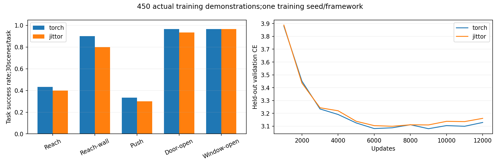

# QueST-Jittor

[QueST: Self-Supervised Skill Abstractions for Learning Continuous Control](https://arxiv.org/abs/2407.15840)（NeurIPS 2024）的 Jittor 小规模复现，保留 PyTorch 版本用于对照。

本仓库选取 MetaWorld 的五个操作任务，使用450条训练示范和100条验证示范，完成动作分词器、条件策略的训练与仿真测试。450条相当于作者4,500条预训练示范数量的10%，不是论文完整45任务和少样本迁移基准的复现。

**当前状态：**五任务基线、12组激活函数对照、保持示范配对实验及独立三种子确认均已完成核验。最后一个 Mish＋GELU 保持分支经解码器数值实现修复后补齐360次仿真；原始精度失败记录保留。详见[实验收尾说明](reports/EXPERIMENT_CLOSEOUT_20261030.md)。

[原论文代码](https://github.com/pairlab/QueST) · [环境配置](#环境配置) · [数据准备](#数据准备) · [训练](#训练) · [测试](#测试) · [实验结果](#实验结果)

## 方法与实现

QueST 先学习怎样把连续动作表示成离散 token，再训练条件策略根据当前观察预测这些 token。执行时，将 token 解码为动作块，执行前几步后重新观察。

```text
32步动作 → 时间卷积 + Transformer → FSQ → 8个动作token
                                            ↓
                                      解码器 → 32步动作

图像 + 机器人状态 + 任务ID → 条件策略 → 预测动作token
```

| 模块 | 本仓库设置 |
|---|---|
| 动作块 | 32步，每步4维控制量 |
| 编码器 | 时间卷积下采样4倍，接2层 Transformer，隐藏维度256 |
| 量化 | FSQ，levels 为 `[8, 5, 5, 5]`，共1,000种索引 |
| 解码器 | 4层 Transformer，将8个 token 还原为32步动作 |
| 图像编码器 | ResNet18 的 stem、layer1、layer2，接 spatial softmax；基线随机初始化 |
| 条件策略 | 6层因果 Transformer，隐藏维度384，6个注意力头 |
| 策略输入 | 128×128 RGB、8维机器人状态和任务ID |
| 执行方式 | top-5采样，每次执行8步后重新观察 |

策略没有自然语言输入，也没有加载 VLM。采集时的39维完整观察仅供专家策略和数据检查使用，不输入学习到的策略。原生 Jittor 的训练与推理不调用 PyTorch；静态权重转换在另一个进程中完成。

## 环境配置

主要 GPU 实验使用以下环境：

| 项目 | 版本或配置 |
|---|---|
| 系统 / Python | Ubuntu 22.04 / Python 3.10.22 |
| GPU | RTX 4090D，24GB显存 |
| CUDA Toolkit / g++ | 12.1 / 11.4 |
| PyTorch / torchvision | 2.2.0＋cu121 / 0.17.0＋cu121 |
| Jittor | 1.3.11.0 |
| NumPy / h5py | 1.26.4 / 3.11.0 |
| MuJoCo / Gymnasium | 2.3.7 / 0.29.1 |
| MetaWorld | 固定提交 `c822f28f582ba1ad49eb5dcf61016566f28003ba` |

建议分开建立 PyTorch 和 Jittor 环境。脚本只创建项目内的 venv，需要系统已有 Python 3.10、g++ 和兼容的 CUDA 环境，不会安装显卡驱动。以下命令在仓库根目录执行。

```bash
bash scripts/bootstrap_linux.sh torch /path/to/python3.10 cu121
bash scripts/bootstrap_linux.sh jittor /path/to/python3.10 cpu

.venv-torch-linux/bin/python -m pip install -r requirements/simulation.txt -c requirements/cpu.txt
.venv-jittor-linux/bin/python -m pip install -r requirements/simulation.txt -c requirements/cpu.txt

.venv-torch-linux/bin/python scripts/linux_preflight.py --output reports/linux_preflight.json
.venv-jittor-linux/bin/python scripts/run_jittor_linux.py --device cuda scripts/jittor_cpu_probe.py --device cuda --output reports/jittor_cuda_probe.json
```

Jittor 安装参数中的 `cpu` 不限制后续使用 GPU；实际设备由 `run_jittor_linux.py --device cuda` 指定。该入口还隔离 CPU/CUDA 编译缓存，处理 Python 配置路径和并行算子编译问题。

无桌面服务器使用 EGL 渲染：

```bash
export MUJOCO_GL=egl
export PYOPENGL_PLATFORM=egl
export NVIDIA_TF32_OVERRIDE=0
```

若提示缺少 `libEGL.so.1`，需要准备系统 EGL 加载库，仅设置环境变量不能代替它。完整依赖见 [requirements/](requirements/)；本地 CPU 试跑和 Linux 基础见[学习路线](docs/LEARNING_ROUTE.md)。

## 数据准备

五任务基线每个任务90条训练、20条验证示范。示范由 MetaWorld 的脚本专家采集，参考作者的采集程序；不是训练好的专家神经网络。划分按 episode 和目标位置隔离，失败示范没有筛除。

| 数据 | 格式 |
|---|---|
| images | `[T, 128, 128, 3]`，uint8 RGB |
| robot_states | `[T, 8]` |
| actions | `[T, 4]` |
| success 等 | 每步执行后的反馈 |

图像和状态取自执行当前动作之前，策略内部将 RGB 除以255。动作块不跨 episode；末尾不足32步时重复最后一个动作，并记录有效位置 mask。

```text
outputs/five_task_10pct_20261029/
├── dataset/
│   ├── data/demonstrations.hdf5
│   ├── records/reach_split_v1.json
│   └── assets/
│       ├── weights.npz
│       ├── config.json
│       ├── shared/tokenizer_shared.pt
│       └── canonical_labels/{train,validation}.npz
└── experiments/
    ├── initial_five.npz
    ├── policy_torch/{best.pt,best_weights.npz,config.json}
    └── policy_jittor/{best_weights.npz,config.json}
```

数据和权重保存在实验归档中，**公开下载地址尚未补充**，只下载源码还不能直接测试已有模型。主数据 SHA256 为 `c899d5923933b57a8957fe20a48554756987f8ab72ae772f8b2adb1f3454fab9`。

采集与转换入口是 [collect_official_reach.py](scripts/collect_official_reach.py) 和 [prepare_five_task_10pct.py](scripts/prepare_five_task_10pct.py)。后者依赖前期三任务目录，不能在空目录里直接运行。[数据与运行说明](docs/REPRODUCTION_GUIDE.md)列出了这些依赖。

若想先跑通接口，可以另建一个 Reach 小数据目录：

```bash
.venv-torch-linux/bin/python scripts/collect_reach.py --root data_runs/reach_demo --episodes 30
.venv-torch-linux/bin/python scripts/prepare_data.py --root data_runs/reach_demo
```

这组无噪声小数据用于试跑，不对应下表中的五任务成绩。作者代码通过 `scripts/fetch_upstream.py` 获取，固定在 `cc25a835a00cf2d91df69704bdd757904d13c061`。

## 训练

下面分步运行五任务基线，使用新输出目录，不覆盖原实验。开始前需要恢复数据、公共分词器初始化和策略初始化，来源见[运行说明](docs/REPRODUCTION_GUIDE.md)。主结果的分词器从已有权重适配10轮，不是从零训练。

### 1. 动作分词器

```bash
QUEST_DATA=outputs/five_task_10pct_20261029/dataset
QUEST_TOKEN_INIT=outputs/gpu_20261028_104533_tokenizer_jittor/best_weights.npz
QUEST_PLAN="$QUEST_DATA/records/tokenizer_plan_readme.npz"
QUEST_JT=(.venv-jittor-linux/bin/python scripts/run_jittor_linux.py --device cuda)

.venv-torch-linux/bin/python scripts/create_batch_plan.py \
  --root "$QUEST_DATA" --output "$QUEST_PLAN" --epochs 10 --batch-size 16 --seed 310300

.venv-torch-linux/bin/python scripts/train_tokenizer.py \
  --root "$QUEST_DATA" --name readme_tokenizer_torch --device cuda \
  --epochs 10 --batch-size 16 --dropout 0 --seed 310300 \
  --initial-weights "$QUEST_TOKEN_INIT" --batch-plan "$QUEST_PLAN"

"${QUEST_JT[@]}" scripts/train_tokenizer_jittor.py \
  --root "$QUEST_DATA" --name readme_tokenizer_jittor --device cuda \
  --epochs 10 --batch-size 16 --dropout 0 --seed 310300 \
  --initial-weights "$QUEST_TOKEN_INIT" --batch-plan "$QUEST_PLAN"
```

两端读取相同权重和批次计划，优化全位置 L1 重建损失，同时记录包含补齐位置的 MAE 和仅真实位置的 MAE。

### 2. 冻结分词器、生成标签

两端条件策略使用同一个原生 Jittor 分词器检查点，避免分词器差异影响策略框架对照。PyTorch 容器转换只准备静态权重。

```bash
QUEST_ASSETS="$QUEST_DATA/readme_assets"
mkdir -p "$QUEST_ASSETS"
cp "$QUEST_DATA/outputs/readme_tokenizer_jittor/best_weights.npz" "$QUEST_ASSETS/weights.npz"
cp "$QUEST_DATA/outputs/readme_tokenizer_jittor/config.json" "$QUEST_ASSETS/config.json"

.venv-torch-linux/bin/python scripts/prepare_policy_stage.py \
  --root "$QUEST_DATA" --framework torch --prepare-checkpoint \
  --tokenizer-weights "$QUEST_ASSETS/weights.npz" --tokenizer-config "$QUEST_ASSETS/config.json" \
  --output "$QUEST_ASSETS/shared"

"${QUEST_JT[@]}" scripts/prepare_policy_stage.py \
  --root "$QUEST_DATA" --framework jittor \
  --tokenizer-weights "$QUEST_ASSETS/weights.npz" --tokenizer-config "$QUEST_ASSETS/config.json" \
  --output "$QUEST_ASSETS/canonical_labels"
```

### 3. 条件策略

```bash
QUEST_POLICY_INIT=outputs/five_task_10pct_20261029/experiments/initial_five.npz

for QUEST_FRAMEWORK in torch jittor; do
  if [ "$QUEST_FRAMEWORK" = torch ]; then
    QUEST_PY=(.venv-torch-linux/bin/python)
    QUEST_EXTRA=(--tokenizer-checkpoint "$QUEST_ASSETS/shared/tokenizer_shared.pt")
  else
    QUEST_PY=("${QUEST_JT[@]}")
    QUEST_EXTRA=()
  fi
  "${QUEST_PY[@]}" scripts/train_controlled_policy.py \
    --root "$QUEST_DATA" --output "$QUEST_DATA/outputs/readme_policy_$QUEST_FRAMEWORK" \
    --framework "$QUEST_FRAMEWORK" --tokenizer-weights "$QUEST_ASSETS/weights.npz" \
    --tokenizer-config "$QUEST_ASSETS/config.json" --initial-weights "$QUEST_POLICY_INIT" \
    --canonical-labels "$QUEST_ASSETS/canonical_labels" \
    --updates 12000 --eval-every 1000 --lr 0.0001 --weight-decay 0.0001 \
    --dropout 0 --shift 0 --seed 310500 "${QUEST_EXTRA[@]}"
done
```

每个 batch 为16个动作块，学习率余弦下降到 `1e-5`。分词器固定，策略按验证集交叉熵选择检查点。每步梯度范数保存在日志中，非有限 loss 或梯度会触发停止。

## 测试

下面测试归档中的原五任务模型，先以开门任务为例。测试新训练模型时，将策略目录与分词器资产一起换成对应的 `readme_policy_*`、`readme_assets` 路径。

```bash
QUEST_DATA=outputs/five_task_10pct_20261029/dataset
QUEST_RUN=outputs/five_task_10pct_20261029/experiments
QUEST_ASSETS="$QUEST_DATA/assets"
QUEST_JT=(.venv-jittor-linux/bin/python scripts/run_jittor_linux.py --device cuda)
QUEST_TASK=door-open-v2
QUEST_TASK_ID=3

.venv-torch-linux/bin/python scripts/evaluate_policy.py \
  --root "$QUEST_DATA" --policy "$QUEST_RUN/policy_torch/best.pt" \
  --tokenizer "$QUEST_ASSETS/shared/tokenizer_shared.pt" --sampling-backend numpy \
  --device cuda --seed-set experiment --seed-start 12000 --episodes 30 \
  --env-name "$QUEST_TASK-goal-observable" --task-id "$QUEST_TASK_ID" \
  --per-episode-sampling --top-k 5 --sampling-seed 30000 --max-steps 150 \
  --action-horizon 8 --videos 0 --name "readme_test_torch_$QUEST_TASK"

"${QUEST_JT[@]}" scripts/evaluate_policy_jittor.py \
  --root "$QUEST_DATA" --policy-weights "$QUEST_RUN/policy_jittor/best_weights.npz" \
  --policy-config "$QUEST_RUN/policy_jittor/config.json" \
  --tokenizer-weights "$QUEST_ASSETS/weights.npz" --tokenizer-config "$QUEST_ASSETS/config.json" \
  --device cuda --seed-set experiment --seed-start 12000 --episodes 30 \
  --env-name "$QUEST_TASK-goal-observable" --task-id "$QUEST_TASK_ID" \
  --per-episode-sampling --top-k 5 --sampling-seed 30000 --max-steps 150 \
  --action-horizon 8 --videos 0 --name "readme_test_jittor_$QUEST_TASK"
```

五任务的 `QUEST_TASK / QUEST_TASK_ID` 依次为：`reach-v2 / 0`、`reach-wall-v2 / 1`、`push-v2 / 2`、`door-open-v2 / 3`、`window-open-v2 / 4`。

每个任务30个场景，最多150步，以环境返回的成功标志计算成功率。12000–12029为本轮已使用的测试种子，继续调参需要另留新场景。输出位于数据根目录的 `outputs/`，包括 `summary.json`、`episodes.jsonl`、逐场景动作和 token 数组。

## 实验结果

### 五任务基线

| 任务 | PyTorch成功/30 | Jittor成功/30 |
|---|---:|---:|
| Reach | 13 | 12 |
| Reach-wall | 27 | 24 |
| Push | 10 | 9 |
| Door-open | 29 | 28 |
| Window-open | 29 | 29 |
| **合计** | **108/150（72%）** | **102/150（68%）** |

这是一个训练种子的结果。两端使用相同初始化、预算、冻结分词器和测试场景，分别按验证集选择模型。分词器最佳验证 MAE（含补齐位置）为 PyTorch `0.111316`、Jittor `0.111657`；策略最佳验证 CE 为 `3.079918`、`3.098897`。[完整报告](reports/FIVE_TASK_10PCT_RESULTS_20261029.md)保留逐任务统计与实验边界。



成功视频：[开门](reports/demos/success_20261030/QueST_Jittor_door-open-v2_success_seed12000_720p.mp4)、[开窗](reports/demos/success_20261030/QueST_Jittor_window-open-v2_success_seed12000_720p.mp4)。视频重放已保存的 Jittor 策略动作，成功和奖励已核对；片尾1秒为标注过的定格，不代表学习到的保持行为，播放帧率也不是模型控制频率。

### PyTorch / Jittor 对齐

使用同一份权重、同一批输入和一致的采样方式。五任务已训练模型的200个验证输入上：

| 检查项 | 结果 |
|---|---:|
| 条件向量最大绝对误差 | `1.1772e-6` |
| 1,600个动作 token | 全部一致 |
| 解码动作最大绝对误差 | `1.8418e-5` |
| 浮点容差 | `atol=2e-5, rtol=2e-4`，通过 |

前向、梯度和短程更新的入口是 `scripts/verify_jittor_alignment.sh`，需要先准备参考 fixture，步骤见[运行说明](docs/REPRODUCTION_GUIDE.md)。长期训练比较真实曲线和指标，不要求两端最终权重逐位相同。早期 K-bias 的严格比较失败和等价性解释保留在 [Jittor运行记录](reports/JITTOR_RUNTIME_STATUS.md)。

## 扩展实验

这些实验用于检查实现和研究提出的问题。不同实验的数据、初始化或场景有所变化，只在各自配对设置内比较。

| 实验 | 观察结果 | 记录 |
|---|---|---|
| 4／8／16步反馈间隔 | 4步未明确优于8步，调用次数约翻倍；16步整体较差 | [报告](reports/FEEDBACK_HORIZON_RESULTS_20261029.md) |
| 均衡采样，3个训练种子 | PyTorch平均68.22%→64.89%，Jittor66.67%→69.11%；未支持稳定提升 | [报告](reports/SAMPLING_STABILITY_RESULTS_20261029.md) |
| ImageNet视觉初始化 | 同样归一化下，PyTorch73%→68%，Jittor69%→66%，本设置未显示收益 | [报告](reports/PRETRAINED_VISION_RESULTS_20261029.md) |
| 补齐损失与保持示范 | Reach单任务中真实保持示范更有效，只有单种子结果 | [结果与限制](reports/EXPERIMENT_CLOSEOUT_20261030.md) |

### 激活函数4×3对照

时间卷积测试 Mish、SiLU、GELU、ReLU；Transformer FFN 测试 GELU、SiLU、ReLU，并统一应用于分词器和条件策略。ResNet 的 ReLU 与 FSQ 变换保持不变。12组从同一份新权重开始，分词器各22,180次更新、策略各12,000次更新，共完成3,600次仿真。

| 时间卷积＋FFN | PyTorch | Jittor | 两端平均 |
|---|---:|---:|---:|
| Mish＋GELU，原始激活 | 91/150 | 95/150 | 62.00% |
| Mish＋ReLU | 101/150 | 102/150 | 67.67% |
| GELU＋ReLU | 101/150 | 100/150 | 67.00% |
| SiLU＋ReLU | 105/150 | 95/150 | 66.67% |

完整[12组结果](reports/ACTIVATION_GRID_RESULTS_20261029.md)、[重建/成功率/耗时数据](reports/ACTIVATION_GRID_COMPARISON_20261030.csv)和[策略曲线](reports/CLOSEOUT_GRID_POLICY_CURVES_20261030.png)均保留。这轮初始化和场景不同，不能把62%与主基线72%直接比较，也不能把单种子最优组合称为稳定改进。不同分词器的 token 语义不同，跨组合的 CE 也不能直接代表控制效果。

### Mish＋ReLU的独立三种子确认

初筛后固定Mish＋GELU与Mish＋ReLU，用3个全新训练种子重新训练，并在新场景完成1,800次评估；原筛选种子不计入确认均值。每个种子内共享初始化、数据顺序和预算，两个框架均完成分词器与策略训练，原数值容差全部通过，没有使用保持示范或解码器精度补丁。

| 框架 | Mish＋GELU均值 | Mish＋ReLU均值 | 平均差值 | 配对训练种子t 95%区间（df=2） |
|---|---:|---:|---:|---|
| PyTorch | 60.89% | 62.89% | +2.00个百分点 | [-2.97, +6.97]个百分点 |
| Jittor | 58.00% | 60.00% | +2.00个百分点 | [-20.40, +24.40]个百分点 |

两框架平均均上升，但区间跨零，不能确认稳定收益。PyTorch三个种子分别持平、+4、+2个百分点；Jittor分别+10.67、+2.67、-7.33个百分点，第三个种子的负结果完整保留。只有3个训练种子，t区间和分层bootstrap都有明显局限；不能把测试场景数或两个框架当成额外独立训练种子。

[完整结果](reports/ACTIVATION_CONFIRMATION_20261030.json)、[结果解释与重建／收敛／耗时](reports/ACTIVATION_CONFIRMATION_REVIEW_20261031.md)、[本机独立核验](reports/ACTIVATION_CONFIRMATION_LOCAL_VERIFICATION_20261031.json)与[归档校验](reports/ACTIVATION_CONFIRMATION_ARCHIVE_VERIFICATION_20261031.json)已保存。


### 优选组合加入保持示范

选取前3组并保留原始激活基线，每组分成有／无保持示范两支，从同一检查点继续训练相同步数。其他四任务不变，使用新场景检查总体成功率和 Reach 连续保持60步的表现。

| 组合 | 框架 | 无保持→有保持，成功/150 | Reach连续保持率 |
|---|---|---:|---:|
| Mish＋ReLU | PyTorch | 101→109 | 13.3%→26.7% |
| Mish＋ReLU | Jittor | 103→100 | 3.3%→26.7% |
| GELU＋ReLU | PyTorch | 101→107 | 23.3%→33.3% |
| GELU＋ReLU | Jittor | 101→100 | 16.7%→26.7% |
| SiLU＋ReLU | PyTorch | 109→108 | 23.3%→16.7% |
| SiLU＋ReLU | Jittor | 108→105 | 23.3%→16.7% |
| Mish＋GELU | PyTorch | 102→95 | 10.0%→13.3% |
| Mish＋GELU | Jittor | 96→94 | 13.3%→16.7% |

保持示范并非对所有组合都有收益。部分 Reach 保持率提高，但五任务总体成绩没有同步提高；Jittor四组的总体成功率均下降。这些结果只有一个训练／微调种子，且先筛选再微调、共享各组已训练的 native 分词器，不能称为稳定提升。

Mish＋GELU保持分支在新 RTX4090 实例补测，只有该补测分支将冻结的 Jittor 解码器12个 LayerNorm 改为 FP64 内部累加，参数与输入输出仍为 FP32；权重、公式、FSQ和策略不变，没有重训。修复后1600个 token 全部一致，动作最大绝对误差2.39089e-5，满足原定联合标准 `abs(error) <= 2e-5 + 2e-4 * abs(reference)`，并非最大误差小于2e-5。原FP32实现的失败仍保留，不能称为未经修改就通过。

[完整第二轮结果](reports/SELECTED_HOLDING_RESULTS_COMPLETED_20261030.json)、[补测说明](reports/HOLDING_COMPLETION_20261030.md)和[本机独立核验](reports/HOLDING_COMPLETION_LOCAL_VERIFICATION_20261030.json)已保存；[原始失败与CPU诊断](reports/DECODER_CPU_DIAGNOSIS_20261030.json)及旧的部分结果不覆盖。

## 日志、曲线和性能

五任务的轻量日志在 [reports/runs/five_task_10pct_20261029/](reports/runs/five_task_10pct_20261029/)：

- [PyTorch分词器](reports/runs/five_task_10pct_20261029/dataset/outputs/five_tokenizer_torch/metrics.csv) / [Jittor分词器](reports/runs/five_task_10pct_20261029/dataset/outputs/five_tokenizer_jittor/metrics.csv)。
- [PyTorch策略训练Log](reports/runs/five_task_10pct_20261029/experiments/policy_torch/metrics.csv) / [Jittor策略训练Log](reports/runs/five_task_10pct_20261029/experiments/policy_jittor/metrics.csv)。
- 各训练目录的 `config.json`、`summary.json` 保存参数与结果；完整归档还包含逐步 `gradients.jsonl`，评估目录包含每个场景的成功/失败记录。
- 12组的[分词器曲线](reports/CLOSEOUT_GRID_TOKENIZER_CURVES_20261030.png)、[策略曲线](reports/CLOSEOUT_GRID_POLICY_CURVES_20261030.png)与[原始JSON](reports/ACTIVATION_GRID_RESULTS_20261029.json)对应保存。

激活对照中 Mish＋GELU 的独占推理计时如下。同一GPU、FP32，预热10次、测量50次并同步，包含输出回传，不含渲染。

| 项目 | PyTorch中位耗时 | Jittor中位耗时 |
|---|---:|---:|
| 分词器 encode→FSQ→decode，batch=16 | 7.234ms | 8.295ms |
| 条件策略生成并解码，batch=1、greedy | 25.162ms | 32.815ms |

入口是 `scripts/benchmark_activation_case.py`，须通过对应激活包装入口运行，见[运行说明](docs/REPRODUCTION_GUIDE.md)。greedy 测速与在线 top-5 评估不同；并发训练的 wall time 另行记录，不用来直接推断框架加速比。

## 目录与来源

```text
src/quest_repro/    PyTorch、原生Jittor模型与公共数据接口
scripts/           采集、训练、测试、对齐和实验入口
requirements/      依赖版本
records/           实验协议
reports/           结果、曲线与轻量日志
docs/              运行说明与补充材料
licenses/          第三方许可证
```

前期30条、100条 Reach 数据与三任务实验整理在[历史实验索引](docs/EXPERIMENT_INDEX.md)，不与主结果混在一起。大数据和权重不直接放进 Git；公开下载地址和干净环境复跑检查仍待补充。

本项目采用 [MIT License](LICENSE)。实现参考 QueST、vector-quantize-pytorch 的 FSQ 和 torchvision ResNet18，来源与原许可证见 [THIRD_PARTY_NOTICES.md](THIRD_PARTY_NOTICES.md)。

README 的组织参考了 Jittor-Sprouts 收录的 [DMANet-Jittor](https://github.com/Yuyciciccc/DMANet-Jittor)、[LIIF-Jittor](https://github.com/WindATree/LIIF-Jittor) 和 [RepVGG-Jittor-CIFAR100](https://github.com/NeikuiColacat/RepVGG-Jittor-CIFAR100)。实验设置、命令与结果来自本仓库实际记录。
