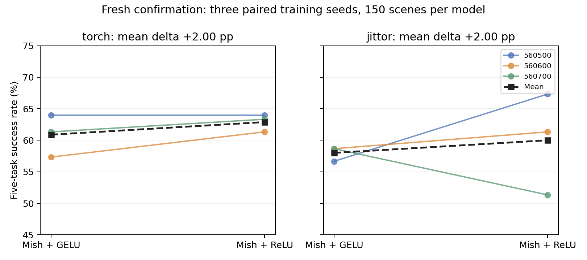

## 扩展实验

这些实验用于检查实现和研究提出的问题。不同实验的数据、初始化或场景有所变化，只在各自配对设置内比较。

| 实验 | 观察结果 | 记录 |
|---|---|---|
| 4／8／16步反馈间隔 | 4步未明确优于8步，调用次数约翻倍；16步整体较差 | [报告](../reports/FEEDBACK_HORIZON_RESULTS_20261029.md) |
| 均衡采样，3个训练种子 | PyTorch平均68.22%→64.89%，Jittor66.67%→69.11%；未支持稳定提升 | [报告](../reports/SAMPLING_STABILITY_RESULTS_20261029.md) |
| ImageNet视觉初始化 | 同样归一化下，PyTorch73%→68%，Jittor69%→66%，本设置未显示收益 | [报告](../reports/PRETRAINED_VISION_RESULTS_20261029.md) |
| 补齐损失与保持示范 | Reach单任务中真实保持示范更有效，只有单种子结果 | [结果与限制](../reports/EXPERIMENT_CLOSEOUT_20261030.md) |

### 激活函数4×3对照

时间卷积测试 Mish、SiLU、GELU、ReLU；Transformer FFN 测试 GELU、SiLU、ReLU，并统一应用于分词器和条件策略。ResNet 的 ReLU 与 FSQ 变换保持不变。12组从同一份新权重开始，分词器各22,180次更新、策略各12,000次更新，共完成3,600次仿真。

| 时间卷积＋FFN | PyTorch | Jittor | 两端平均 |
|---|---:|---:|---:|
| Mish＋GELU，原始激活 | 91/150 | 95/150 | 62.00% |
| Mish＋ReLU | 101/150 | 102/150 | 67.67% |
| GELU＋ReLU | 101/150 | 100/150 | 67.00% |
| SiLU＋ReLU | 105/150 | 95/150 | 66.67% |

完整[12组结果](../reports/ACTIVATION_GRID_RESULTS_20261029.md)、[重建/成功率/耗时数据](../reports/ACTIVATION_GRID_COMPARISON_20261030.csv)和[策略曲线](../reports/CLOSEOUT_GRID_POLICY_CURVES_20261030.png)均保留。这轮初始化和场景不同，不能把62%与主基线72%直接比较，也不能把单种子最优组合称为稳定改进。不同分词器的 token 语义不同，跨组合的 CE 也不能直接代表控制效果。

### Mish＋ReLU的独立三种子确认

初筛后固定Mish＋GELU与Mish＋ReLU，用3个全新训练种子重新训练，并在新场景完成1,800次评估；原筛选种子不计入确认均值。每个种子内共享初始化、数据顺序和预算，两个框架均完成分词器与策略训练，原数值容差全部通过，没有使用保持示范或解码器精度补丁。

| 框架 | Mish＋GELU均值 | Mish＋ReLU均值 | 平均差值 | 配对训练种子t 95%区间（df=2） |
|---|---:|---:|---:|---|
| PyTorch | 60.89% | 62.89% | +2.00个百分点 | [-2.97, +6.97]个百分点 |
| Jittor | 58.00% | 60.00% | +2.00个百分点 | [-20.40, +24.40]个百分点 |

两框架平均均上升，但区间跨零，不能确认稳定收益。PyTorch三个种子分别持平、+4、+2个百分点；Jittor分别+10.67、+2.67、-7.33个百分点，第三个种子的负结果完整保留。只有3个训练种子，t区间和分层bootstrap都有明显局限；不能把测试场景数或两个框架当成额外独立训练种子。

[完整结果](../reports/ACTIVATION_CONFIRMATION_20261030.json)、[结果解释与重建／收敛／耗时](../reports/ACTIVATION_CONFIRMATION_REVIEW_20261031.md)、[本机独立核验](../reports/ACTIVATION_CONFIRMATION_LOCAL_VERIFICATION_20261031.json)与[归档校验](../reports/ACTIVATION_CONFIRMATION_ARCHIVE_VERIFICATION_20261031.json)已保存。

### 优选组合加入保持示范

选取前3组并保留原始激活基线，每组分成有／无保持示范两支，从同一检查点继续训练相同步数。其他四任务不变，使用新场景检查总体成功率和 Reach 连续保持60步的表现。

| 组合 | 框架 | 无保持→有保持，成功/150 | Reach连续保持率 |
|---|---|---:|---:|
| Mish＋ReLU | PyTorch | 101→109 | 13.3%→26.7% |
| Mish＋ReLU | Jittor | 103→100 | 3.3%→26.7% |
| GELU＋ReLU | PyTorch | 101→107 | 23.3%→33.3% |
| GELU＋ReLU | Jittor | 101→100 | 16.7%→26.7% |
| SiLU＋ReLU | PyTorch | 109→108 | 23.3%→16.7% |
| SiLU＋ReLU | Jittor | 108→105 | 23.3%→16.7% |
| Mish＋GELU | PyTorch | 102→95 | 10.0%→13.3% |
| Mish＋GELU | Jittor | 96→94 | 13.3%→16.7% |

保持示范并非对所有组合都有收益。部分 Reach 保持率提高，但五任务总体成绩没有同步提高；Jittor四组的总体成功率均下降。这些结果只有一个训练／微调种子，且先筛选再微调、共享各组已训练的 native 分词器，不能称为稳定提升。

Mish＋GELU保持分支在新 RTX4090 实例补测，只有该补测分支将冻结的 Jittor 解码器12个 LayerNorm 改为 FP64 内部累加，参数与输入输出仍为 FP32；权重、公式、FSQ和策略不变，没有重训。修复后1600个 token 全部一致，动作最大绝对误差2.39089e-5，满足原定联合标准 `abs(error) <= 2e-5 + 2e-4 * abs(reference)`，并非最大误差小于2e-5。原FP32实现的失败仍保留，不能称为未经修改就通过。

[完整第二轮结果](../reports/SELECTED_HOLDING_RESULTS_COMPLETED_20261030.json)、[补测说明](../reports/HOLDING_COMPLETION_20261030.md)和[本机独立核验](../reports/HOLDING_COMPLETION_LOCAL_VERIFICATION_20261030.json)已保存；[原始失败与CPU诊断](../reports/DECODER_CPU_DIAGNOSIS_20261030.json)及旧的部分结果不覆盖。

## 日志、曲线和性能

五任务的轻量日志在 [reports/runs/five_task_10pct_20261029/](../reports/runs/five_task_10pct_20261029/)：

- [PyTorch分词器](../reports/runs/five_task_10pct_20261029/dataset/outputs/five_tokenizer_torch/metrics.csv) / [Jittor分词器](../reports/runs/five_task_10pct_20261029/dataset/outputs/five_tokenizer_jittor/metrics.csv)。
- [PyTorch策略训练Log](../reports/runs/five_task_10pct_20261029/experiments/policy_torch/metrics.csv) / [Jittor策略训练Log](../reports/runs/five_task_10pct_20261029/experiments/policy_jittor/metrics.csv)。
- 各训练目录的 `config.json`、`summary.json` 保存参数与结果；完整归档还包含逐步 `gradients.jsonl`，评估目录包含每个场景的成功/失败记录。
- 12组的[分词器曲线](../reports/CLOSEOUT_GRID_TOKENIZER_CURVES_20261030.png)、[策略曲线](../reports/CLOSEOUT_GRID_POLICY_CURVES_20261030.png)与[原始JSON](../reports/ACTIVATION_GRID_RESULTS_20261029.json)对应保存。

激活对照中 Mish＋GELU 的独占推理计时如下。同一GPU、FP32，预热10次、测量50次并同步，包含输出回传，不含渲染。

| 项目 | PyTorch中位耗时 | Jittor中位耗时 |
|---|---:|---:|
| 分词器 encode→FSQ→decode，batch=16 | 7.234ms | 8.295ms |
| 条件策略生成并解码，batch=1、greedy | 25.162ms | 32.815ms |

入口是 `scripts/benchmark_activation_case.py`，须通过对应激活包装入口运行，见[运行说明](REPRODUCTION_GUIDE.md)。greedy 测速与在线 top-5 评估不同；并发训练的 wall time 另行记录，不用来直接推断框架加速比。
