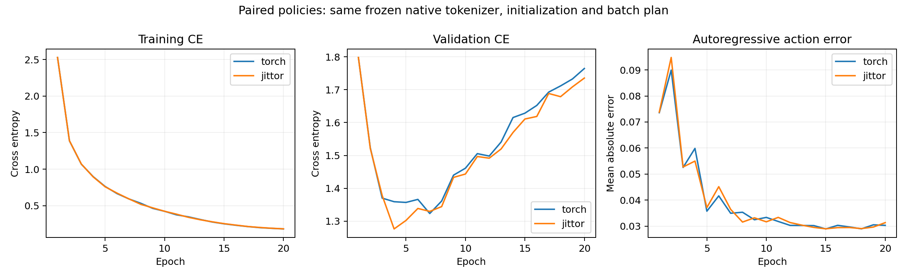

# 条件策略GPU训练与开发集仿真：2026-10-28

本轮19:20启动，约19:35正常完成。完整状态、原始日志和模型备份位于
`policy_gpu_completed_20261028/outputs/`，SHA256校验说明见同名ZIP旁的JSON。

## 固定设置

- 使用上一轮原生Jittor分词器的最佳权重，冻结后同时供两套策略使用。
- 两端专家动作标签在全部1176训练窗口和298验证窗口上整数完全一致。
- 同一full policy初始NPZ（seed456），同一20轮batch计划，batch16，dropout0。
- 图像128×128、8维机器人状态、task ID；没有语言模型、图像预训练或图像增强。
- 两端各1480次更新；按验证交叉熵选择最佳checkpoint。
- 开发种子2000–2004，greedy top1，每次执行8步，最多150步。最终种子1000–1019未使用。

## 实际结果

| 项目 | PyTorch | 原生Jittor |
|---|---:|---:|
| 正式训练轮数 | 20 | 20 |
| 最佳验证CE | 1.323512 | 1.276619 |
| 最佳CE对应轮数 | 7 | 4 |
| 正式训练耗时 | 95.67秒 | 162.69秒 |
| 开发集成功次数 | 2/5 | 1/5 |
| 开发集成功率 | 40% | 20% |
| 成功率Wilson95%区间 | [11.8%,76.9%] | [3.6%,62.4%] |

Jittor首次一轮检查还包含新算子的编译，不包含在上表正式20轮计时中。
训练及仿真程序均确认没有导入Torch；Jittor环境没有安装Torch。
5个开发种子不足以推断框架性能高低。两端训练轨迹相近但并非逐位相同，且各自最佳checkpoint的轮数不同。

训练CE持续下降而验证CE后期升高，显示小数据过拟合信号。验证CE、自由生成动作误差和闭环成功率分别衡量不同问题，不能相互替代。

## 同一训练后权重的推理检查

将训练后的Jittor最佳权重分别交给两端，在6个验证episode各取起点0和1，共12个输入：

- 96个生成token整数完全一致。
- 条件特征最大绝对误差6.85e-7。
- 解码动作最大绝对误差5.36e-7。
- 保持原阈值atol=2e-5、rtol=2e-4。

证据：[比较报告](policy_trained_weights_prediction_comparison.json)。这支持已训练模型在这些输入上的推理一致性，不代表两端独立训练的权重完全一致，也不代表所有闭环状态均已验证。

## 视频与日志

- [Jittor成功案例，seed2000](demos/policy_jittor_success_dev2000.mp4)：30步成功。
- [Jittor失败案例，seed2001](demos/policy_jittor_failure_dev2001.mp4)：150步未成功。
- 视频为真实仿真调试录像，480px；最终汇报视频的高清录制另行准备。
- 原始训练日志：[Torch](runs/policy_gpu_20261028_112009_torch/metrics.csv)、[Jittor](runs/policy_gpu_20261028_112009_jittor/metrics.csv)。
- 原始开发集记录：[Torch](runs/policy_gpu_20261028_112009_torch_dev5/episodes.jsonl)、[Jittor](runs/policy_gpu_20261028_112009_jittor_dev5/episodes.jsonl)。
- 配置、Wilson区间和逐回合结果：[汇总JSON](policy_pair_summary_20261028.json)。

## 备份与后续

本机已下载并验证141242349字节的备份ZIP，SHA256：
`0b3d85b753b3cc370b469d72d9e7f26e2237fa6dd722aea51e07c904acbbb9c3`。
含真实日志、曲线、视频、最佳策略权重与冻结分词器。完整优化器checkpoint仍在服务器。

目前已跑通单任务小规模的数据→分词器→条件策略→仿真执行链，泛化效果仍有限。
后续需分析失败案例、决定是否扩充演示和增加验证，再冻结协议运行最终测试；GitHub、PPT、讲解视频及用户对代码的掌握仍待完成。服务器保持开机，本轮任务已结束。
